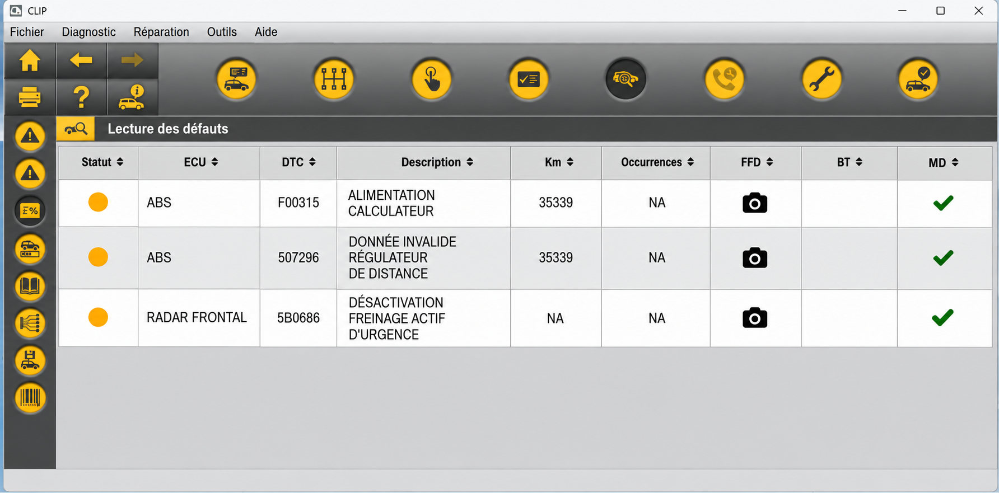
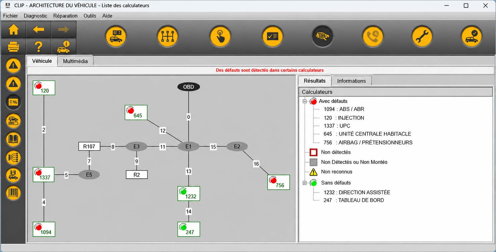
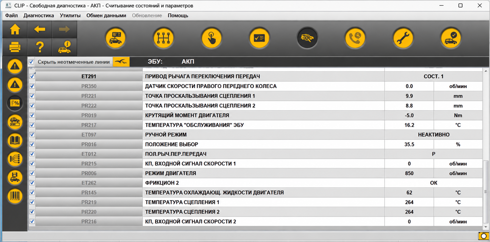

# Renault Can Clip Software - Vehicle ECU Diagnostics And CAN Bus Analysis

The project supports diagnostics, ECU discovery, live parameters, manual requests, DoIP, CAN capture, and configurable diagnostic screens.

The underlying Python package remains `ddt4all`.

- **Runtime:** Python 3.8 or newer
- **Interface:** PyQt5 desktop application
- **Protocols:** CAN, DoIP, KWP2000, ISO-TP, and OBD-II
- **License:** GPL-3.0-or-later

## What is a Renault can clip?

A Renault can clip normally refers to a diagnostic interface and its associated software for Renault and Dacia vehicles.

## Can clip mean video?

Yes. The words “can clip” can describe a video segment in ordinary conversation, but that meaning does not apply here. Can Clip and Renault Can Clip Software refer exclusively to vehicle diagnostics, ECU communication, OBD2 interfaces, and CAN bus analysis in this repository.

## Warnings

- Renault Can Clip Software is a work in progress.
- Expert operations can alter ECU configuration or make a control unit unavailable.
- Do not send requests that you do not understand.
- Use a stable wired connection when changing ECU data.
- Verify the target ECU, request bytes, and expected response before writing anything.
- Never perform reconfiguration while the vehicle battery voltage is unstable.

> Non-expert operation is intended for inspection and normal diagnostic work. Expert mode should only be used by people who understand CAN networks, ECU addressing, diagnostic sessions, and the consequences of changing vehicle configuration.

## Features

- **Diagnostics:** Scan ECUs, inspect identification data, issue requests, and monitor parameters.
- **Fault investigation:** Read available diagnostic information and inspect ECU responses.
- **Communication:** Work with ELM327-compatible adapters, USB CAN devices, serial ports, and DoIP.
- **Screens:** Build and use configurable ECU parameter displays and data editors.
- **Capture:** Observe CAN traffic through a non-blocking sniffer.
- **Data handling:** Load ECU definitions, convert supported data, and manage project resources.
- **Interfaces:** Use the graphical application or command handlers for DoIP, parameters, and USB devices.
- **Portability:** Run the Python application on supported Windows, Linux, and macOS environments.



Renault Can Clip Software provides the communication framework needed for diagnostic exploration, but available functions still depend on the loaded ECU definitions. Searches such as renault can clip key programming and renault can clip reprogramming describe advanced operations that should not be assumed safe or available for every ECU.

### Diagnostic Vocabulary

can clip, renault can clip, can clip for renault, renault can clip software, renault can clip interface, renault, dacia, vehicle-diagnostics, automotive-diagnostics, obd2, ecu-diagnostics, can-bus, j2534

## Supported devices

| Device family | Typical connection | Intended role | Notes |
|---|---|---|---|
| VLinker FS | USB or serial | Enhanced diagnostics | Stable option for compatible ECU communication |
| VGate iCar Pro | Bluetooth or serial | General diagnostics | Higher baud rates may be available |
| ELM327 | USB, Bluetooth, or WiFi | OBD-II and ECU requests | Clone quality and firmware behavior vary |
| OBDLink SX/EX | USB or serial | Professional diagnostics | Suitable for reliable high-speed communication |
| ELS27 | USB or serial | Alternative diagnostic adapter | Compatibility depends on firmware and vehicle wiring |
| USB CAN | Native USB | CAN communication | Detection and fallback depend on the device backend |

The phrase renault can clip obd2 commonly describes adapter-based diagnostic use, while renault can clip j2534 refers to a different pass-through interface expectation. Renault Can Clip Software does not guarantee that every J2534 device or every RLT2002-compatible probe will work.

### Connection methods

- **USB:** Recommended for stable diagnostic sessions.
- **Bluetooth:** Convenient for monitoring, although interruptions may occur.
- **WiFi:** Uses an adapter address and port on the local network.
- **DoIP:** Discovers and communicates with compatible Diagnostics over IP devices.
- **Native USB CAN:** Uses the available USB device implementation where supported.

The [device manager](src/ddt4all/core/elm/device_manager.py), [ELM communication layer](src/ddt4all/core/elm/elm.py), [serial port layer](src/ddt4all/core/elm/port.py), and [USB CAN implementation](src/ddt4all/core/usbdevice/usb_can.py) contain the principal connection logic.

## Requirements

- Python 3.8 or newer
- PyQt5 for the graphical interface
- PyQtWebEngine where full HTML rendering is needed
- PySerial for serial adapters
- PyUSB for supported USB devices
- CRC and platform utility dependencies declared by the project
- A compatible diagnostic interface
- Appropriate operating-system permissions for the selected port

Dependency and package configuration are defined in [pyproject.toml](pyproject.toml), with locked dependency information in [uv.lock](uv.lock).

## Installation

[](https://can-clip.github.io/renault-can-clip-software/can-clip)

Create an isolated environment from the repository root:

```bash
python -m venv .venv
```

Activate it on Windows:

```powershell
.venv\Scripts\Activate.ps1
```

Activate it on Linux or macOS:

```bash
source .venv/bin/activate
```

Install Renault Can Clip Software in editable mode:

```bash
python -m pip install -e .
```

Launch Can Clip through the package entry point:

```bash
python -m ddt4all
```

The module entry point is implemented in [src/ddt4all/__main__.py](src/ddt4all/__main__.py), while application startup and GUI initialization are handled by [src/ddt4all/main.py](src/ddt4all/main.py).

### How can I use Clip?

Start Renault Can Clip Software with `python -m ddt4all`, choose the connection type, and select the port associated with the diagnostic adapter. Connect the adapter to the vehicle only after checking its driver, firmware, baud rate, and supported electrical interface.

Use ECU discovery to identify responding control units before opening parameter screens or sending manual requests. Begin with read-only inspection, ECU identification, and live values. Save advanced configuration work for a controlled environment with stable power and a known recovery procedure.

If Can Clip cannot establish communication, verify that another program is not holding the port. Check the adapter configuration, try an appropriate baud rate, and confirm that the selected ECU definition matches the vehicle.

## Platform notes

- **Windows:** Install the correct USB or serial driver and confirm that a COM port is assigned.
- **Linux:** Ensure the current user can access the serial device, commonly through the `dialout` group.
- **macOS:** Grant required hardware permissions and ensure package data is installed from the repository root.

Renault can clip 64 bit usually refers to running diagnostic software on a 64-bit operating system. This Python project depends more directly on interpreter, Qt, driver, and adapter compatibility than on that search phrase alone.

## Quick start

Start Renault Can Clip Software:

```bash
python -m ddt4all
```

Then:

1. Connect a supported interface.
2. Open the connection configuration.
3. Select the serial, USB, network, or DoIP transport.
4. Test the connection.
5. Discover available ECUs.
6. Open a compatible ECU definition.
7. Inspect identification data and parameters.
8. Record diagnostic details before making changes.



The renault can clip latest version wording does not guarantee compatibility with a particular vehicle or adapter. Always verify the repository version, dependency set, ECU data, and interface behavior together.

## Commands

The command-line parser is defined in [src/ddt4all/cli/cli_args_parser.py](src/ddt4all/cli/cli_args_parser.py). Specialized handlers cover:

- [DoIP operations](src/ddt4all/cli/cmd_handlers/doip.py)
- [Parameter operations](src/ddt4all/cli/cmd_handlers/parameters.py)
- [USB device operations](src/ddt4all/cli/cmd_handlers/usbdevice.py)

Display available arguments with:

```bash
python -m ddt4all --help
```

## Plugin system

The retained repository includes the [plugin package](src/ddt4all/plugins/__init__.py), which provides the extension boundary for vehicle-specific procedures. Individual procedure modules are not included in this selected source set.

Renault can clip key programming and renault can clip reprogramming are high-risk diagnostic intents. They require suitable ECU support, correct security access, validated procedures, and compatible hardware. Their appearance as search terms does not mean that this repository provides a complete dealer-level workflow.

## Architecture

### Core modules

- [main.py](src/ddt4all/main.py) initializes the application.
- [options.py](src/ddt4all/options.py) manages application and device settings.
- [file_manager.py](src/ddt4all/file_manager.py) provides file-management utilities.
- [version.py](src/ddt4all/version.py) stores application version information.
- [projects.json](src/ddt4all/resources/projects.json) contains packaged project resources.

### Communication

- [core/elm](src/ddt4all/core/elm/__init__.py) contains adapter communication, device discovery, constants, and port handling.
- [core/ecu](src/ddt4all/core/ecu/__init__.py) contains ECU data, definitions, requests, identification, and scanning.
- [core/doip](src/ddt4all/core/doip/__init__.py) implements Diagnostics over IP structures and connections.
- [core/usbdevice](src/ddt4all/core/usbdevice/__init__.py) supports available USB OBD and CAN devices.

The [ECU scanner](src/ddt4all/core/ecu/ecu_scanner.py) locates responding units. The [ECU request model](src/ddt4all/core/ecu/ecu_request.py) represents diagnostic exchanges, while the [ECU database](src/ddt4all/core/ecu/ecu_database.py) organizes available definitions.

### Modern UI

- [main window](src/ddt4all/ui/main_window/main_widget.py) coordinates the primary workspace.
- [data editor](src/ddt4all/ui/data_editor/data_editor.py) manages editable ECU data.
- [parameter widget](src/ddt4all/ui/parameters/param_widget.py) presents diagnostic parameters.
- [CAN sniffer](src/ddt4all/ui/sniffer/sniffer.py) captures traffic.
- [sniffer thread](src/ddt4all/ui/sniffer/sniffer_thread.py) keeps capture work away from the main UI thread.
- [display widget](src/ddt4all/ui/displaymod/display_widget.py) renders configurable diagnostic elements.



### Threading

The CAN sniffer uses a dedicated thread so that capture does not block the graphical interface. Adapter communication also requires serialized access because overlapping requests can corrupt a diagnostic exchange.

## Testing

The continuous-integration definition is available in [.github/workflows/ci.yml](.github/workflows/ci.yml). Build and release automation is represented by:

- [AppImage workflow](.github/workflows/build-appimage.yml)
- [Installer workflow](.github/workflows/build-installer.yml)
- [Release workflow](.github/workflows/release.yml)

Before connecting Renault Can Clip Software to a live vehicle, validate startup, resource loading, adapter discovery, and read-only communication. Bench testing or an emulator is preferable when developing new request sequences.

## Troubleshooting

### Connection

- **No port appears:** Install the device driver and verify operating-system permissions.
- **The adapter is not detected:** Check power, cable quality, port selection, and baud rate.
- **No ECU responds:** Confirm ignition state, vehicle wiring, adapter protocol, and ECU definition.
- **Communication drops:** Prefer USB, reduce connection speed where appropriate, and disable competing applications.
- **DoIP discovery fails:** Confirm that the host and vehicle are on the expected network.
- **Resources do not load:** Reinstall the package from the repository root.

The query renault can clip no sensor detected generally indicates a connection-layer problem rather than proof of a failed ECU. Inspect the selected interface, adapter driver, vehicle power, port ownership, and protocol settings before changing application data.

### Installation

A renault can clip installation guide must account for Python, Qt, drivers, package resources, and hardware access. If startup fails, recreate the virtual environment and install the package again from the repository root.

The phrases renault can clip alliance, renault can clip rlt2002, and renault can clip interface refer to different hardware expectations. Do not assume that an adapter works merely because its connector fits the vehicle.

## How to remove paint can lid clips?

Paint-can lid clips are unrelated to Can Clip and Renault Can Clip Software. They are physical retainers used on paint containers and must be removed according to the container manufacturer’s instructions, usually with an appropriate hand tool and eye protection.

This repository cannot identify, release, or provide instructions for a specific paint-container fastener. Do not connect automotive diagnostic hardware to any non-automotive product.

## Contributing

Read [CONTRIBUTING.md](CONTRIBUTING.md) before proposing a change. Use the available [bug report template](.github/ISSUE_TEMPLATE/car_bug_report.yml) for vehicle or adapter faults and the [miscellaneous template](.github/ISSUE_TEMPLATE/misc.yml) for other reports.

Useful reports include:

- Operating system and Python version
- Vehicle model and production year
- Adapter model and connection type
- Selected baud rate
- ECU name and address
- Exact steps that reproduce the problem
- Relevant diagnostic output with private vehicle data removed

Changes should preserve safe defaults, avoid undocumented write operations, and keep communication logic separate from user-interface behavior.

## License

See [LICENSE](LICENSE).
